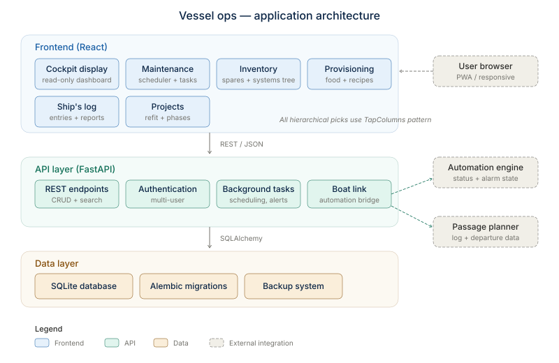

<!--
Purpose: How the mx-inv app is put together - process layout, backend modules and routers,
  frontend feature layout, the /cockpit route, and one worked request flow.
Version: v10 (2026-11-04) - v10: status line corrected (schema v39, Ship's PC host, review-batch). v9 (2026-10-09) - v9: boat_link also calls the engine's /fill (cockpit Tanks). v8 (2026-10-07) - v8: rebuild-from-spec pass - status line current (v38, laptop interim host); process layout names the deck-log thread, boat_link.py and the engine's call-back; first-run paragraph now covers the migration runner; backend list gains boat_link / handover_card / log_stamp / deck_log / logbook_report / migrations, routers logbook + meal_plan, cockpit + reports current; /cockpit paragraph current; integrations table complete (boat stack per BOAT-STACK-ON-PI.txt, events token, deck log, briefings dir, Claude CLI). v7 (2026-10-05) - v7: cockpit Sail Plan -> our SignalK `sails.activeSet` (HB-09); the previous developer's sail-config webhook retired. v6 (2026-09-24) - v6: deploy 22 - the SPA catch-all section rewritten (404 JSON for /api misses, files only from inside dist, the path traversal it closed); build/CI paragraph brought current (Dockerfile, CI with pytest); stack-review pointer. v5: deploy 20 / schema v36 - status line current (was still v34); settings router + SettingsDialog, first-run ensure_initialised(), GET /api/cockpit/capabilities, the opt-in integrations boundary (env vars) and a release-tooling section. v4: TapColumns kit + StorageColumns / SystemCascade in the component list; endpoint inventory brought current (tool accessories, storage moves + favorites, recipe save-back); Warehouse has 7 sub-tabs. v3 (2026-09-23) - v3: components list brought current for deploy 14 (AppNav v3, RecordLink, SearchPick, keep-alive tabs). v2 (2026-09-22) - v2: schema v34 live (deploy 10, d54252c) - OutcomeFields.tsx in the
  schedule feature, follow-ons in the tasks router and history_report.py lines. v1: header added; module/router/feature lists brought current (reports,
  documents, device_research; history_report.py; the Log tab's two views; TaskReferencedBy).
Scope: PRODUCTION - engineering documentation for the mx-inv app.
Architecture: mx-inv wiki page. Read after Home.md; Data-Flows-and-Interfaces.md covers the
  edges, Logic-Flows.md the business logic, Operations.md how to run and deploy it.
Invocation: n/a (reference doc).
-->

# Architecture



**Current as of 2026-11-04:** live is schema **v39** on :8000 (branch `logbook-page`, the Ship's PC as
normal host at 192.168.1.100:8000) - the newest pieces are the link to the boat's automation stack (`backend/boat_link.py`),
the logbook / ship's log with its automatic deck log thread, passages, review-batch, and the start-time migration
runner (`migrations/`); v39 waits on branch `review-batch`. Before that: owner Settings,
first-run DB creation, opt-in integrations and `tasks.schedule_from` (deploy 20),
`synchronous = FULL` (deploy 21), and the hardened SPA fallback (deploy 22, below). The same code also builds the generic release package (see
[Release package tooling](#release-package-tooling)). The stack was reviewed the same day and
kept - see [Design Decisions](Design-Decisions.md#keep-the-stack) and the phased hardening plan
in `design/ARCH_HARDENING_PLAN.md`.

## Process layout

One Python process, one Node/React build. No message queue, no separate
worker, no external database server. Inside the process there is one background thread - the
automatic deck log (`backend/deck_log.py`, started by `main.py` only when `MXINV_SIGNALK_URL` is set and
`MXINV_DECK_LOG` is not `off`) - and, while a device-research job runs, one worker thread plus its
`claude -p` child process. Outbound HTTP to the boat's automation stack (rules engine, SignalK, history
read API on the Pi) all goes through `backend/boat_link.py`; the rules engine calls back in with
`POST /api/logbook/events` ([Data Flows ⑦ ⑧](Data-Flows-and-Interfaces.md)).

```
                     ┌─────────────────────────────┐
   browser  ───────► │  FastAPI  (backend/main.py)  │
  (any LAN/           │  uvicorn, port 8000          │
   Tailscale           │                               │
   device)             │  /api/*     → routers/*.py    │
                     │  /cockpit   → frontend/dist    │
                     │  /routing/* → reverse proxy ────┼──┐
                     │  /*         → frontend/dist(SPA)│  │
                     └──────────────┬───────────────┘  │
                                     │ imports directly (same process,  │
                                     │ no HTTP hop)                     │
                                     ▼                                  │
                     ┌─────────────────────────────┐                   │
                     │  data.py (~6,200 lines)       │                   │
                     │  db_schema.py (DDL)           │                   │
                     │  ~230 top-level functions     │                   │
                     └──────────────┬───────────────┘                   │
                                     │ sqlite3, one connection per call, │
                                     │ busy_timeout=5000, WAL mode       │
                                     ▼                                  │
                     ┌─────────────────────────────┐                   │
                     │  vessel_local.db (SQLite)     │                   │
                     └─────────────────────────────┘                   │
                                                                        ▼
                                                    ┌──────────────────────────────┐
                                                    │  passage-planner web app         │
                                                    │  (separate repo/venv/CI)       │
                                                    │  uvicorn, 127.0.0.1:8100       │
                                                    │  internal only - never on the  │
                                                    │  firewall, only reachable via  │
                                                    │  mx-inv's own proxy above      │
                                                    └──────────────────────────────┘
```

**`/routing` is an HTTP reverse proxy, not an import merge** (added
2026-09-17, same day as the routing web GUI itself): `backend/main.py`'s
`/routing/{path:path}` catch-all (registered before the SPA fallback so it
wins the route match) forwards the request via `httpx` to routing's own
FastAPI app on `127.0.0.1:8100`, started separately by `run-live.bat`.
Keeps the two repos, venvs, and dependency trees (routing's weather/GPX/
docx stack is heavier and unrelated to mx-inv's) fully independent while
still exposing both from one external port/URL - see
[Cockpit / Deck GUI](Cockpit-GUI.md) for why `/cockpit` gets to skip this
(it's a route inside *this* repo, not a separate app) and
[Design Decisions](Design-Decisions.md#routing-reverse-proxied-not-merged)
for the fuller rationale. **The proxy is opt-in** (deploy 20): `main.py` only
registers the `/routing` routes when `MXINV_ROUTING_URL` is set; `run-live.bat` v5 sets
it to `http://127.0.0.1:8100`, a release install leaves it unset and has no `/routing`.

**First run creates the database.** At import, `main.py` calls
`db_schema.ensure_initialised()`: if `VESSEL_DB_PATH` (default `vessel_local.db`) is
missing, zero bytes, or has no tables at all, it runs `_init_fresh()` (full schema + the
generic compartment seed). A file with ANY tables is left alone. **Then it migrates**
(`db_schema.ensure_current()` -> the `migrations/` runner, since 2026-10-05): a file behind the code is
backed up (verified) and brought to the code's schema version one step per transaction; a file NEWER
than the code raises `SchemaTooNew` and the server does not start. Details:
[Schema](Schema.md).

Two ways to run it (see [Operations](Operations.md) for the actual commands):

- **Dev**: `uvicorn backend.main:app --reload` (port 8000) + `npm run dev` in
  `frontend/` (port 5173, Vite dev server). `vite.config.ts` proxies `/api`
  to 8000. Hot-reload on both sides.
- **Prod**: `frontend/dist` is built once (`npm run build`) and served
  directly by FastAPI's `StaticFiles` mount + an SPA-fallback catch-all route
  (`backend/main.py`, last 15 lines) — one process, one port, no dev server.
  `run-live.bat` automates the build-then-serve sequence.

**The SPA catch-all (deploy 22):** an unmatched GET under `/api/` answers **404 JSON**; any
other unmatched path gets `index.html` (so `/cockpit` and deep links survive a reload); a real
file is served only if it resolves **inside** `frontend/dist`. Before deploy 22 an unmatched
`/api/...` GET got `index.html` with a 200 - which is how the slash-named-device bug hid until
v32 (every `/api/tasks/systems/{name}` route now uses `{name:path}` so names like "Berth A/C"
route correctly) - and an encoded `..%2F` path could fetch any file, the database included.
Tests: `tests/test_api_edges.py`. A write can still answer 200 while dropping a field (see
below), so write tests read the value back from the DB.

There is deliberately **no separate API-only deployment mode** distinct from
"serves its own frontend" — the trial/prod path is the same code either way,
just pointed at a different `VESSEL_DB_PATH`.

## Backend structure

```
backend/
  main.py         FastAPI app, CORS (wide open — see below), router
                   registration, health check, SPA static-file fallback
  scheduling.py    the 8-bucket schedule projection (see Logic Flows)
  util.py          clean_nan / df_records (pandas → JSON-safe), not_found()
  print_sheet.py   the print-on-demand checklist sheet (one standalone HTML page,
                   fitted to a letter page in the browser; assets/ holds the
                   bow-art letterhead) - GET /api/tasks/{id}/checklist/print.
                   Boat name comes from Settings (blank = omitted), as in
                   history_report.py
  history_report.py the printable maintenance-history ("CARFAX") page - whole
                   vessel / one system / one device, chronological, standalone
                   HTML with the letterhead - GET /api/report/history. Prints the
                   device's identity (make/model, installed, serial, warranty -
                   v32); cost/vendor only with ?cost=1, and (v33) then also
                   which invoice each entry was paid under; (v34) badges an
                   entry's outcome and its open/closed follow-on count
  device_research.py  tracker #50: runs the Claude Code CLI headless
                   (`claude -p`, OAuth subscription token, Read tool only, cwd
                   = the manuals folder: Settings `manuals_root`, else env
                   MXINV_MANUALS_ROOT; unset = feature reports unavailable.
                   Exe override MXINV_CLAUDE_EXE, HYLAS_CLAUDE_EXE still honoured) to draft one device's tree entry from
                   its manual; validates the reply as JSON, never writes the DB
  device_research_jobs.py  in-memory job registry for the above: one job at
                   a time on a background thread, poll/cancel, finished draft
                   saved to var/device_research/research_<id>_<slug>.json
  vessel_log.py    outbound webhook broker to the previous developer's InfluxDB "logbook"
                   measurement — disabled by default, fire-and-forget; no endpoint
                   ever existed, so a no-op (log_incident has no caller since v37)
  sail_plan.py     sail-plan vocabulary + rules (HB-09) - the cockpit writes SignalK sails.activeSet
                   via boat_link.py (2026-10-05; replaced the sail_config.py webhook)
  boat_link.py     THE one connection to the boat's automation stack: env-configured
                   URLs + token files, engine_get/post (rules engine /status, /mode,
                   /ack, /fill), signalk_self/get/publish (REST read, websocket delta write +
                   read-back), history_at/latest (history read API); every failure a
                   plain-words BoatLinkError (502/503)
  handover_card.py the pre-filled watch-handover card from one SignalK snapshot +
                   history "value at T" (units, staleness limits, tank instances)
  log_stamp.py     the logbook's auto-stamp (now = card + mode + sail set; back-dated
                   = history at that time); best-effort, never blocks an entry
  deck_log.py      the automatic deck log thread (hourly under way, 08:00 / 20:00
                   otherwise; idempotent per slot; missed slots skipped) + the one-line
                   status_line() used by engine events too
  logbook_report.py the printable ship's log (day / range / passage) - HTML
  migrations/      (repo root, not backend/) the schema runner: vNNN_*.py steps,
                   run at start by db_schema.ensure_current(); `python -m migrations`
  routers/
    schedule.py     GET /api/schedule  (the only route — all the work is
                     in scheduling.py)
    tasks.py        tasks, checklists, systems & devices (patch / items /
                     rename / clone / delete - all `{name:path}`), task-item
                     demand, task references/cross-links, retire/unretire,
                     referenced-by, and the maintenance history under
                     /api/tasks/completions (list, facets, performed-by pick
                     list, historical backfill, void; v33 adds filing an entry
                     under an invoice; v34 adds outcome + follow-ons on
                     complete / historical and POST .../{id}/follow-ons)
                     (largest router, ~53 routes)
    items.py        catalog + stock lots + movements + type/policy lookups;
                     item <-> system links (PUT /{id}/systems); tool <-> accessory
                     links (many-to-many, v29) and GET /{id}/accessories (a
                     tool's accessories, the reverse view)
    storage.py       compartments/locations/containers: list / add / rename /
                     delete at each level (deletes 409 rather than orphan
                     stock); PATCH a location's compartment_id or a container's
                     location_id MOVES it (a container takes its stock along);
                     a container's `favorite` flag drives the picker's chips
    projects.py      projects + their task lists
    recipes.py       recipe book + structured ingredient parsing/consumption
                     (+ metric->imperial ingredient conversion, and
                     `GET /{id}/convert-text`, the body-text proposal; v35:
                     POST /{id}/ingredients/changes - plan/cook edits saved back
                     onto the recipe, one transaction, tracker #71)
    units.py         the governed `units` picklist (list/create/rename/delete;
                     schema v21) - items and recipe ingredients reference it
    audits.py        inventory-audit walk (start/count/progress/close)
    telemetry.py     engine/genset hours, fuel/water levels
    provisioning.py  galley crew/weeks prefs, aisle order, shopping list
    cockpit.py       /api/cockpit: capabilities {sail_plan, incident, weather, boat,
                     boat_write, handover_live}, ping (heartbeat), watch-handover/wx
                     (routing briefing read), watch-handover/boat (the card), sail-plan
                     GET/POST, boat (engine status), mode, ack
    logbook.py       /api/logbook: crew entries, status updates, this-watch, the watch
                     entry, departure / arrival, passages, ports, and POST /events (the
                     rules engine's push - the only route with a bearer token)
    meal_plan.py     /api/meal-plan: plan entries, overrides, protein, made-it, pantry
                     check, the meal-plan shopping list
    settings.py      GET/PUT /api/settings - owner Settings (vessel_name,
                     engine_label, genset_label, manuals_root) over
                     data.get_settings / update_settings (system_config rows);
                     unknown keys -> 400
    device_research.py  the "Research with Claude" manual-reading jobs (#50):
                     /api/device-research - GET /status, POST (start, form
                     fields), GET /{job_id} (poll), DELETE /{job_id} (cancel)
    reports.py       GET /api/report/history - the printable service history
                     (renders through history_report.py; HTML, not JSON); GET
                     /api/report/logbook - the printable ship's log (logbook_report.py)
    documents.py     (v33) invoices / receipts on
                     file - /api/documents: list, years, expense classes, the
                     per-year view, its CSV download, CRUD. Design:
                     design/INVOICE_DOCUMENTS_DESIGN.md
```

Every router is a **thin wrapper over `data.py`** — request in, call the
matching `data.py` function, JSON out. There is no service/repository layer
between routers and `data.py`; `data.py` *is* the service layer, unchanged
from the Streamlit era. This is deliberate (see
[Design Decisions](Design-Decisions.md)) — the data layer was already solid
and framework-agnostic, so the rewrite's entire job was UI, not data access.

Request bodies for most `PATCH`/`PUT` endpoints take a loose
`dict[str, Any]` rather than a fully-typed Pydantic model per field —
mirrors `data.py`'s own `**fields` kwargs pattern. Acceptable for a near-1:1
structural port; would need tightening if OpenAPI-driven frontend codegen
ever becomes a goal. The two known exceptions where a typed Pydantic model
*was* required: `PUT /api/tasks/{id}/project` and `/parent`, because
`Body(..., embed=True)` on an `Optional[int]` mishandles an explicit JSON
`null` (FastAPI/pydantic quirk) — worth remembering for any future optional
body field. The newer routes (historical records, completion void/filing,
documents, system updates) do use typed pydantic models - and there **a
field must be declared in both the pydantic model and the frontend TS type**,
or it is silently dropped while the write still answers 200 (bit twice with
the v32 device-identity columns).

**CORS is wide open** (`allow_origins=["*"]`) and **there is no
authentication anywhere in the stack**. This is intentional, not an oversight
— the trust boundary is the LAN/Tailscale network itself, not the
application. See [Design Decisions](Design-Decisions.md#no-auth) and
[Operations](Operations.md#access--network) for what that means in practice.

## Frontend structure

```
frontend/src/
  api/
    client.ts    fetch wrapper, ApiError class (.status/.detail — lets call
                 sites branch on a structured error like a 409 duplicate)
    types.ts     TypeScript types mirroring backend/scheduling.py's JSON
                 shape field-for-field, snake_case, no transform layer
    date.ts      todayLocal() — local-timezone date helper (see Logic Flows,
                 completion-date bug)
    units.ts     useUnits()/useCreateUnit() - the units picklist hooks
    settings.ts  useSettings() / useUpdateSettings() - owner Settings (boat name, meter labels, manuals folder)
  components/
    FocusScreen.tsx  the ONE focus-screen primitive (`useFocusTrail<T>()` +
                     `<FocusScreen>`): repaint with one record, a breadcrumb
                     trail and a "← Back" that goes ONE level; used by
                     management, projects, schedule, recipes, meal plan and
                     the locker
    ConfirmDialog.tsx  `<ConfirmProvider>` (mounted in main.tsx, wraps the desktop
                     app AND /cockpit) + `useConfirm()`: the one tap-safe in-app
                     confirmation for every delete / remove / abandon / move
                     ([Design Decisions](Design-Decisions.md#tap-safe-confirm)); no
                     code calls the browser `confirm()` any more
    UnitPicker.tsx   governed unit <select> (imperial-first, "＋ New unit…" FIRST,
                     shows a legacy unit an item still carries)
    AppNav.tsx       v3 cross-tab navigation (App.tsx provides it): `openRecord({kind,…},
                     returnTo)` opens an item / task / system / project / recipe /
                     container on the tab that owns it; each tab wraps its content in a
                     `NavScopeProvider` (how to describe "here", what it opens in place);
                     `useAnchoredFocus` / `useReturnRestore` send Back to the exact origin.
                     No provider on /cockpit, so names render as plain text
                     ([Design Decisions](Design-Decisions.md#clickable-to-detail))
    RecordLink.tsx   RecordLink (a tappable record name), CheckRow (tick box + name as two
                     targets), SystemTaskLabel (system chip + task as two targets)
    SearchPick.tsx   the one type-to-search pick list, inline "＋ New …" as the FIRST row
                     ([Design Decisions](Design-Decisions.md#no-detour-workflows));
                     features/warehouse/ItemPick.tsx (FoodPick / StuffPick),
                     are built on it
    TapColumns.tsx   the tap-columns kit for TREES (overlay, trigger button, row,
                     "＋ New …" row; TapColumns.css): warehouse/StorageColumns
                     (Compartment › Location › Container - ContainerPicker v4 via
                     ContainerCascade, Edit Storage Structure, its Move… dialogs)
                     and management/SystemCascade (System › Device - SystemPicker
                     v3, ServesEditor, SystemScreen Move… / delete-reassign)
    SettingsDialog.tsx  the header's "⚙ Settings" dialog (GET/PUT /api/settings). The
                     header reads "⚓ <boat name>" and sets document.title to it; a
                     blank name falls back to "Vessel Ops Panel" and the
                     button reads "⚙ Set up your boat"
  App.tsx keeps every visited tab MOUNTED (hidden) - likewise the Warehouse and Galley
  sub-tabs - so a cross-tab trip never loses unsaved ticks or half-filled forms.
  features/
    schedule/       the main desktop landing screen — 8-bucket board,
                     single-select timeframe tabs, expand-to-detail cards
                     (Done/Defer inline; "Open full record →" hands off to
                     Management's TaskDetail as a focus screen). The Complete
                     panel and the backfill form share PerformedByField ("who
                     did the work": crew roster + names already in the
                     history, a <datalist>, free text still accepted) and
                     (v34) OutcomeFields.tsx - OutcomePicker ("How did it
                     go?") and FollowOnEditor (follow-on task rows, shown for
                     Problem found / Partly done; the editor alone is reused
                     by the Log's "＋ Follow-on task…"). A follow-on task's
                     card and TaskDetail show "↩ Follow-on from <job>"
                     (FollowOnOrigin, exported from TaskCardDetail).
                     The "🧾 Log" tab (CompletionLog) is the maintenance
                     history, with two views: **Service history** (filters,
                     void, "＋ Past service record" = HistoricalRecordForm,
                     "🖨️ Printable report" opening /api/report/history) and
                     **Invoices on file** (v33:
                     InvoicesPanel + InvoiceForm + useDocuments - per-year,
                     per-expense-class, CSV, and "File under invoice" on each
                     history entry)
    management/      unified task + checklist admin view (search/filter,
                     inline edit, ChecklistSteps — reused by 3+ other
                     features), the Systems & devices list (light, collapsed
                     tree) and SystemScreen (one system/device: details incl.
                     identity - installed on / serial / warranty, v32 -
                     devices, tasks, parts, rename/move/delete, "📋 Clone
                     with rename"; DeviceResearchPanel = the #50 "Research
                     with Claude" button + draft review), task
                     cross-references. focusKeys.ts is the shared trail
                     vocabulary (task | system) also used by Projects.
                     2026-09-20: ChecklistSteps renders steps AND linked
                     tasks in one order (per-run ticks, Print link, a
                     "Details" button per line); StepDetail (a step's
                     Details screen); TaskNeeds ("What you need": parts /
                     tools with have + where stowed, editable list).
                     2026-09-22 (#66): TaskReferencedBy - one "Referenced
                     by" panel on a task's record (project, parent
                     checklist, ALL inbound task links) replaced
                     TaskInChecklists (deleted); retire/unretire lives here
    projects/        project list (compact rows) -> ProjectScreen (tasks,
                     add-existing, new-task) -> task focus screen
    warehouse/       maintenance supply only — Locker, Add New Stuff,
                     Restock List, Work a Container, Inventory Audit,
                     Expiry/Inspection Due (spares & safety, excludes
                     food), Edit Storage Structure — 7 sub-tabs. Storage is
                     walked with StorageColumns (Compartment › Location ›
                     Container): the ContainerPicker overlay, the Edit
                     Storage Structure screen and its Move… dialogs
    galley/          top-level "🍽️ Galley" tab (added 2026-09-17, GUI-only
                     split from Warehouse — see Design Decisions) — hosts
                     Galley Provisioning / Recipe Book / Meal Plan as its
                     own sub-tabs, kept out of the Warehouse nav entirely
    recipes/         recipe book -> RecipeFocus; CookFlow (shared with meal
                     plan); ingredient review/parsing UI; ConvertToImperial
    mealplan/        meal plan working list -> MealPlanEntryFocus (recipe body
                     + the shared CookFlow, see Design Decisions)
    provisioning/     galley crew/weeks/aisle-order/shopping-list
    telemetry/       header widget — fuel/water %, engine/genset hours (meter
                     labels from Settings engine_label / genset_label)
    run-checklist/    focused single-checklist "run" screen
    layup-return/    bulk-defer tool for an extended-absence return
    cockpit/         separate `/cockpit` route — see below
```

**Focus screens.** A list item that has a full detail, a child list or an
editing form opens as its own screen, not inline (the owner's rule, 2026-09-18 - see
[Design Decisions](Design-Decisions.md#focus-screens-not-inline)). Each feature
keeps its list mounted but `hidden` while a record is focused, so search,
filters, tab, scroll and expanded cards survive "← Back"; the trail is a stack,
so a jump inside a record (task -> its system, project -> task) adds a level.
"← Back" goes exactly one level and the breadcrumb ("Systems › Propulsion ›
Main Engine › a task") jumps to any earlier one; following a link to something
already on the trail walks back to it instead of stacking a duplicate
([Design Decisions](Design-Decisions.md#one-navigation-model)). The primitive is
`components/FocusScreen.tsx`. Deliberately still inline: the Storage tree
(a browsing hierarchy), Receive, and the telemetry widget.

State: React Query for all server state (no Redux/Zustand — the app has no
meaningful client-only state beyond form drafts and UI toggles). Every
mutation invalidates the relevant query key on success rather than
optimistically patching local state — mirrors the old Streamlit app's
`st.rerun(scope="app")` full-re-derive behavior, traded deliberately for
simplicity over perceived snappiness.

**No router library.** `/cockpit` is a real, deep-linkable URL, resolved by a
single `window.location.pathname.startsWith('/cockpit')` check in `main.tsx`
that picks `<CockpitApp/>` vs. the main `<App/>` at mount time. This works
because both the FastAPI SPA fallback and Vite's dev server already serve
`index.html` for any non-API path — no routing config needed on either side
for this to survive a reload or deep link. If the app ever needs more than
two top-level routes, this hand-rolled switch is the first thing to
reconsider (react-router or similar).

## The `/cockpit` route {#the-cockpit-route}

A second, independent UI surface (`frontend/src/features/cockpit/`) built
2026-09-16 for helm/companionway tablets — high-contrast, big touch targets,
CSS-only responsive breakpoint (`min-width: 700px`) between a phone-sized
"glance" layout and a denser tablet "work" layout. One component tree for
both device tiers, no separate code paths. Home tiles (2026-10-05): Watch Handover (the pre-filled
boat card, This watch, Log this watch, then the real checklist-run flow), Run a Checklist (reuses
`ChecklistSteps` from `management/` wholesale), Sail Plan (HB-09 sail set -> SignalK; hidden without a
SignalK write token on live code, always on in v39), Break / Incident (writes the mx-inv logbook),
Depart / Arrive (passages); an alarm banner + Ack on every screen and the boat-mode card on home when
the rules engine is configured. `cockpit.py` holds the boat-stack and weather routes; the logbook routes
are in `logbook.py`. What is hidden depends on `GET /api/cockpit/capabilities`.
Full scope, device architecture, and implementation detail:
[Cockpit / Deck GUI](Cockpit-GUI.md).

## Data flow example: completing a scheduled task

1. User clicks **Complete** on a `TaskCard` in `ScheduleBoard.tsx` (or inside
   `TaskCardDetail.tsx`'s expanded view, which also handles item consumption).
2. `mutations.ts`'s `useCompleteTask` fires `POST /api/tasks/{id}/complete`.
3. `routers/tasks.py` calls `data.complete_task(...)`, which sets
   `last_completed_date`, clears `deferred_units`, appends a row to the
   append-only `task_completions` history (with `performed_by`), and — if items were
   selected for consumption — writes `stock_movements` rows with
   `reason='task_consume'` and decrements `stock.quantity`.
4. On success, the React Query mutation invalidates the `['schedule']` query
   key.
5. The next render re-fetches `GET /api/schedule`, which re-runs
   `scheduling.schedule_snapshot()` from scratch against the now-updated DB —
   the task moves buckets (or clears entirely) because the projection is
   always computed fresh, never cached. This is the same "just re-derive
   everything" philosophy the old Streamlit app used
   (`st.rerun(scope="app")`), carried forward deliberately rather than
   building incremental client-side state patching.

## Why one repo, two languages, no build orchestration

There's no monorepo tool (no Nx/Turborepo). `frontend/` is just a directory with its own
`package.json`; on the laptop `run-live.bat` is the entire build pipeline (`npm run build` then
`uvicorn`). For the Pi there is a two-stage `Dockerfile` (built by CI, not deployed - see
[Operations](Operations.md#docker-image)), and GitHub Actions CI runs the API smoke test, the
pytest regression suite (`tests/`, see [Operations](Operations.md#tests)), the frontend build and
the image build on every push. That matches the scale - one deployment target at a time, a few
users - rather than being an oversight.

## Integrations boundary (environment switches) {#integrations-boundary}

Everything that talks to something outside this app is off unless configured, so the
same code runs on this boat and on a stranger's laptop. `run-live.bat` (v11) sets the live
values; a release install sets none of them.

| Switch | Turns on | Live value |
|---|---|---|
| `MXINV_ROUTING_URL` | the `/routing` reverse proxy | `http://127.0.0.1:8100` |
| `MXINV_INFLUX_URL` + `MXINV_INFLUX_ORG` (+ `MXINV_INFLUX_BUCKET`, default `boat`; `MXINV_INFLUX_GENSET_MATCH`, default `generator,genset`) | `telemetry_sync.py` v2 hours/levels pull; unset = hand-entered hours only | `192.168.1.10:8086`, org `boat-auto`, match `generator,genset,westerbeke` |
| `VESSEL_LOG_ENABLED` + `VESSEL_LOG_ENDPOINT` (+ `_TOKEN`) | the completion webhook to the previous developer's logbook (`vessel_log.py`) - Break / Incident no longer depends on it (it writes the mx-inv logbook) | off (never built) |
| `MXINV_SIGNALK_URL` (+ `MXINV_SIGNALK_TOKEN_FILE` / `_TOKEN` for writes) | handover card, logbook stamps, the deck log thread; with the token, the Sail Plan write (`boat_link.py`, `sail_plan.py`) | `http://192.168.1.10:3000` with `BOAT-STACK-ON-PI.txt`, else `127.0.0.1:3000`; token file `%USERPROFILE%\.boat-secrets\mxinv-signalk.env` |
| `MXINV_ENGINE_URL` (+ `MXINV_ENGINE_TOKEN_FILE` / `_TOKEN` for writes) | cockpit alarms / mode card; with the token, mode tap + ack; the mode on every stamp | `http://192.168.1.10:8200` with `BOAT-STACK-ON-PI.txt`, else `127.0.0.1:8210` (the Ship's PC port); token file `%USERPROFILE%\.boat-secrets\engine.env` |
| `MXINV_EVENTS_TOKEN` (else the same key in the engine token file) | accepts the rules engine's `POST /api/logbook/events` | from `engine.env` |
| `MXINV_HISTORY_URL` | handover card "this watch", back-dated stamps, the sail set after a SignalK restart | `http://192.168.1.10:8090` with `BOAT-STACK-ON-PI.txt`, else `127.0.0.1:8090` |
| `MXINV_DECK_LOG` | `off` stops the deck log thread | `off` only on an interim host without the stack (`LIVE-HOST-INTERIM.txt` and no `BOAT-STACK-ON-PI.txt`) |
| `MXINV_ROUTING_BRIEFINGS_DIR` | where the cockpit weather line reads routing briefings | unset (sibling `..\routing\var\briefings`) |
| `MXINV_CLAUDE_EXE` (old: `HYLAS_CLAUDE_EXE`), `CLAUDE_CODE_OAUTH_TOKEN` | device research: which CLI, and its subscription token | token = a user env var; exe found on PATH / the desktop app |
| `MXINV_MANUALS_ROOT` | device research, when Settings `manuals_root` is blank | not needed - Settings holds it |
| `VESSEL_DB_PATH` | which database file | unset (`vessel_local.db`) |

Boat-specific *values* (name, meter labels, manuals folder) are not env vars - they are
owner Settings in `system_config`, edited in the app.

## Release package tooling {#release-package-tooling}

A generic copy of the app for other boats, built from this repo; nothing in it is
imported by the running app.

- `scripts/release/build_release.py` (STANDALONE) - allowlist copy (backend/, data.py,
  db_schema.py, telemetry_sync.py, frontend source, example_data.py,
  load_starter_pack.py, docs/USER_GUIDE.md, docs/dev/, and `release_files/` at the package
  root) -> builds `frontend/dist` inside the package -> runs the privacy gate -> zips to
  `code/mx-inv-release-out/vessel-ops-panel-<version>.zip`. A privacy hit = no zip.
- `scripts/release/privacy_scan.py` - the gate: scans the built bundle, Python *string*
  values (not comments/docstrings) and every other shipped text file for this boat's
  people, names, places, hosts and paths. **Never shipped** (its word list is the private
  names).
- `release_files/` - the package's own README, INTEGRATIONS.md, CLAUDE.md, requirements.txt
  (pinned), setup/run launchers for Windows (`.bat`, CRLF) and Mac (`.command`, LF, zipped
  executable), the generic device-research instructions, and `starter_packs/*.json`
  (`REVIEW.md` beside them is the owner's review list, not shipped).
- `example_data.py` - fictional "SV Example" for a fresh DB (refuses a non-empty one).
- `load_starter_pack.py` - `recipes | maintenance` [--dry-run]; idempotent by name; stamps
  library tasks with `schedule_from` = load day; run-hours items with no meter load as-used.
- `scripts/release/export_starter_packs.py` (not shipped) - read-only export from the live
  DB through a deterministic generalisation/drop map, writing the packs + REVIEW.md.
- `docs/USER_GUIDE.md`, `docs/dev/{ARCHITECTURE,SCHEMA,DESIGN_RULES,GOTCHAS_AND_TESTING}.md`
  - the shipped docs; this wiki stays private.

How to build and test one: [Operations](Operations.md#building-a-release-package). Why it
is shaped this way: [Design Decisions](Design-Decisions.md#release-package).
